# Candidate Communication Platform

Recruiters manage candidates, send them single or bulk messages through a messaging provider, watch delivery status update live, see why a message failed, and browse each candidate's communication history.

All five bonus features are built: **retrying failed messages**, **provider health**, **message templates**, **scheduled messages** and **a second provider (email through Resend)** with a channel picker. See [Bonus features](#bonus-features).

**Live:** https://ccp.karthikdileep.in · API docs: https://ccp.karthikdileep.in/api/docs/

| Layer | Stack |
| --- | --- |
| Frontend | Next.js 16 (App Router), React 19, TypeScript (strict), Material UI 9, TanStack Query, react-hook-form + zod |
| Backend | Python 3.12, Django 5.2 LTS, Django REST Framework, drf-spectacular, Celery + Redis, PostgreSQL 16 |
| Providers | SMS through a separate Django service that simulates a vendor (see [Provider simulator](#provider-simulator)); email through [Resend](https://resend.com) (optional) |
| Infra | Docker Compose, GitHub Actions, one GCP Compute Engine VM behind nginx + Let's Encrypt |

## Screenshots

<table>
  <tr>
    <td width="50%">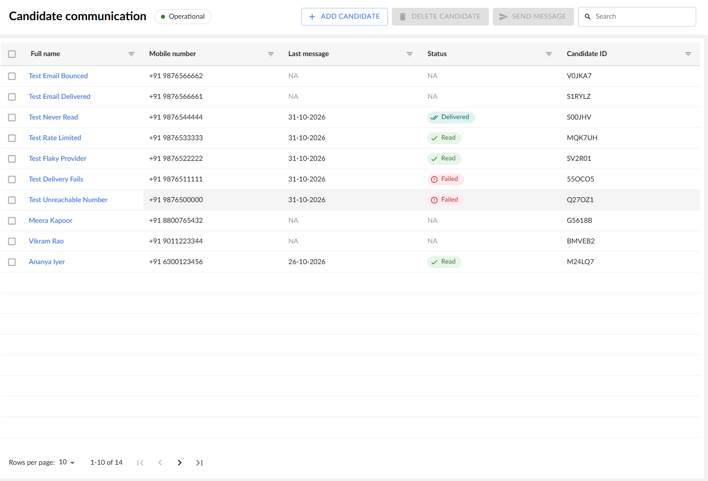<br><sub><b>Candidates.</b> Latest message and status per candidate; search, sort and filter by column.</sub></td>
    <td width="50%">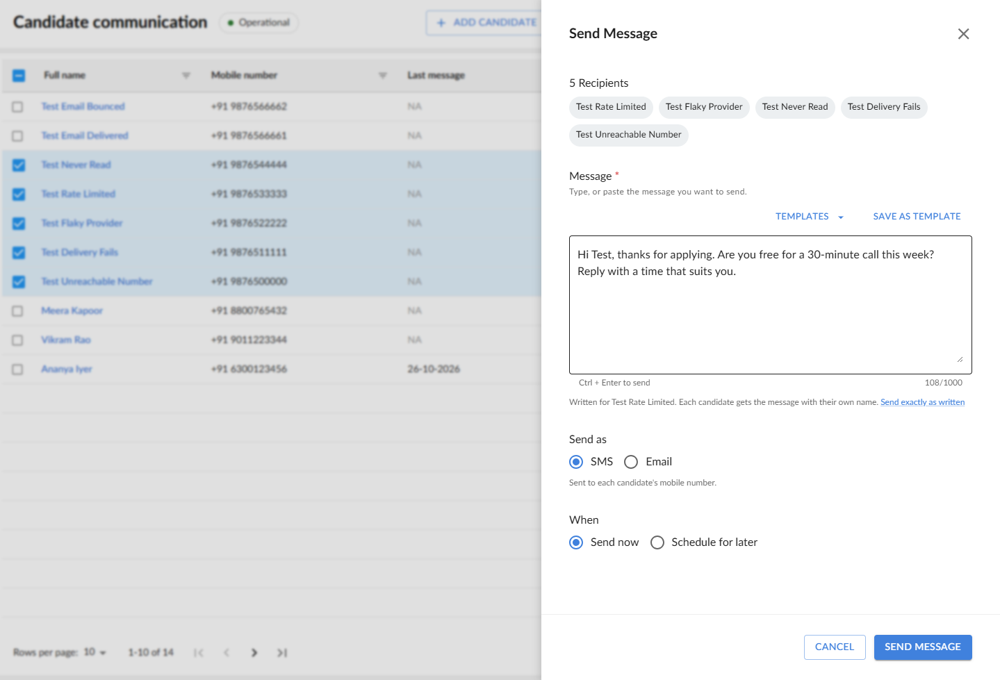<br><sub><b>Send.</b> Recipients, a template written for the first candidate, channel and schedule.</sub></td>
  </tr>
  <tr>
    <td>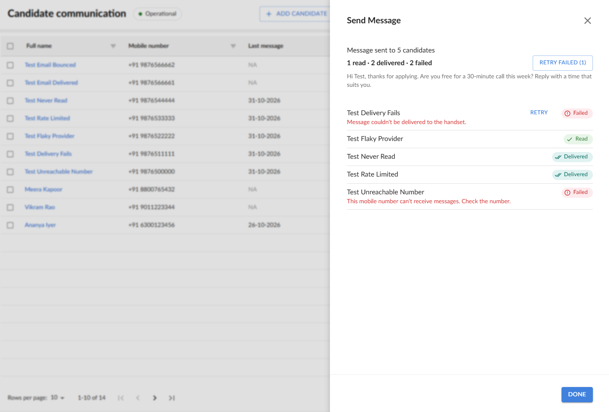<br><sub><b>Live results.</b> Statuses fill in as webhooks arrive; failures say why, and Retry appears only where it can help.</sub></td>
    <td>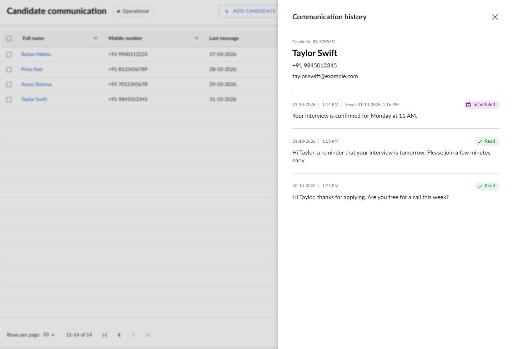<br><sub><b>History.</b> Every message to a candidate, newest first, including scheduled ones.</sub></td>
  </tr>
  <tr>
    <td>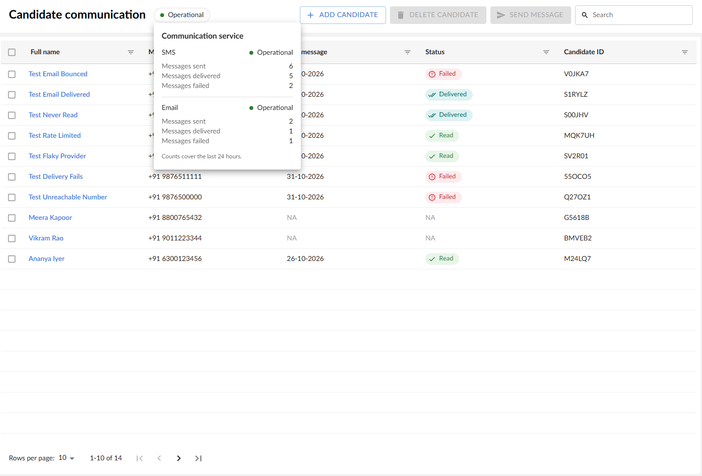<br><sub><b>Provider health.</b> Status and 24-hour counts per provider.</sub></td>
    <td>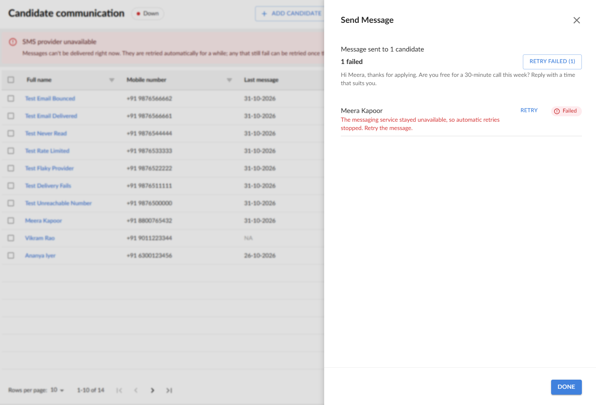<br><sub><b>Outage.</b> The header turns Down with a banner; automatic retries give up and the recruiter can retry.</sub></td>
  </tr>
</table>

---

## Quick start (Docker)

Requires Docker Desktop.

```bash
cp .env.example .env
docker compose up --build -d
docker compose exec api python manage.py seed_demo_data
```

| Service | URL |
| --- | --- |
| App | http://127.0.0.1:3000 |
| API + Swagger | http://127.0.0.1:8000/api/docs/ |
| Provider simulator | http://127.0.0.1:8001 |

Use `127.0.0.1` rather than `localhost`: on Windows, `localhost` tries IPv6 first and Docker's IPv6 forward can hang. Postgres is published on host port 5433 so it does not clash with a local install.

`seed_demo_data` adds everyday candidates with past messages, one candidate per [test number](#test-numbers), two candidates on Resend's test inboxes and three message templates. `--reset` deletes all candidates first.

**Email (optional):** put a Resend API key in `.env` as `RESEND_API_KEY` to turn on the email channel. Without it the app offers SMS only. For delivery webhooks, add a webhook in Resend for `{public URL}/api/v1/webhooks/resend/` and set `RESEND_WEBHOOK_SECRET`; without one, email statuses are picked up by the reconciliation job after five minutes.

## Local development (hot reload)

Only Postgres and Redis run in Docker; copy each service's `.env.example` to `.env` first.

```bash
docker compose up -d postgres redis

cd backend && uv sync && uv run python manage.py migrate
uv run uvicorn config.asgi:application --reload --port 8000
uv run celery -A config worker -l info --pool=solo      # --pool=solo on Windows
uv run celery -A config beat -l info

cd provider-simulator && uv sync && uv run python manage.py migrate
uv run uvicorn config.asgi:application --reload --port 8001
uv run celery -A config worker -l info --pool=solo

cd frontend && npm install && npm run dev               # proxies /api to :8000
```

After changing a backend serializer or endpoint, run `npm run gen:api` in `frontend/`: it exports the OpenAPI schema and regenerates the TypeScript types. CI fails if either drifts.

## Tests and checks

Same as CI:

```bash
# backend/ and provider-simulator/
uv run ruff format --check . && uv run ruff check . && uv run mypy . && uv run pytest

# frontend/
npm run lint && npm run typecheck && npm test && npm run build
```

| Suite | What it covers |
| --- | --- |
| Backend (pytest, 233) | API contracts, validation, the status state machine (every transition pair), dispatch and retries, webhook signatures and dedupe, reconciliation, SSE, search, filters, sorting, idempotent sends, manual retry, health, templates, scheduling, the Resend adapter |
| Simulator (pytest, 43) | Messaging API, idempotency, lifecycle, signed webhooks and retries, test numbers, fault injection |
| Frontend (Vitest, 31) | Error copy, status chips, recipient chip overflow, add-candidate validation, URL state parsing, sort order, out-of-order live updates, template previews |
| End-to-end (Playwright) | Add a candidate, send, watch it get read, check history, delete. Needs the full stack: `E2E_BASE_URL=http://127.0.0.1:3000 npm run test:e2e` |

CI runs the three unit suites, the schema and type drift checks, and a Docker build on every push.

---

## Architecture

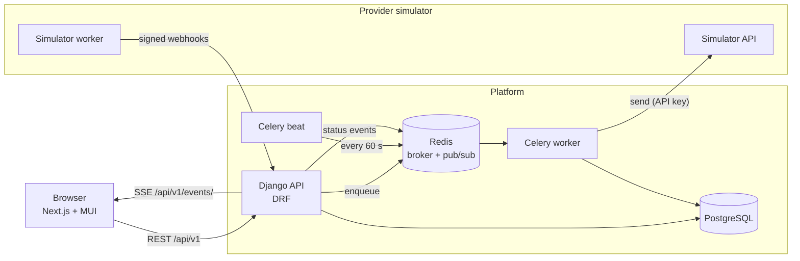

```text
backend/             Django platform: API + Celery. Apps under candidate_comms/:
                     core, api, candidates, communications, integrations, webhooks, realtime
provider-simulator/  Django provider simulator, reached only over HTTP
frontend/            Next.js app: src/app, src/features/<feature>, src/components, src/theme, src/lib
docker/              Postgres init, nginx (production)
```

### Backend layout

- **Thin views** (HackSoft styleguide): input serializer, then a service (writes, transactional) or a selector (reads), then an output serializer. No business logic in views, serializers or models.
- **One error envelope** for every API error: `{"error": {"code", "message", "fields"}}`. The frontend maps each `code` to recruiter-facing copy; raw exceptions never reach the client.
- **Messaging gateway**: providers sit behind a `MessagingGateway` interface and a registry. Vendor errors are mapped to normalised `GatewayError` subclasses, each saying whether it is retried automatically, whether the recruiter may retry it, and what the recruiter sees.
- **Status state machine**: every status change goes through one function. Statuses have ranks and only move forward; duplicates are no-ops and late (out-of-order) updates are recorded but not applied.

```text
QUEUED ─▶ SENT ─▶ DELIVERED ─▶ READ
   │        │         │
   └────────┴─────────┴──▶ FAILED
```

### Sending a message

The API answers immediately; each recipient is sent by its own task, so one bad number or slow call never holds up the others.

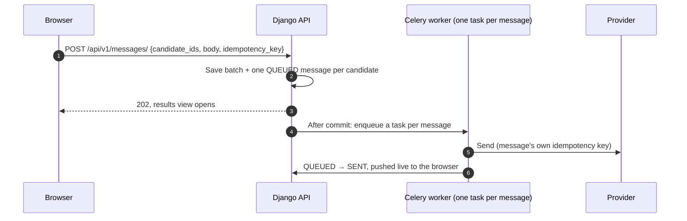

The `idempotency_key` on the request makes a resend after a lost response return the original batch instead of messaging everyone again. Each message also carries its own key to the provider, so a retried task is never delivered twice.

### Delivery updates, live in the browser

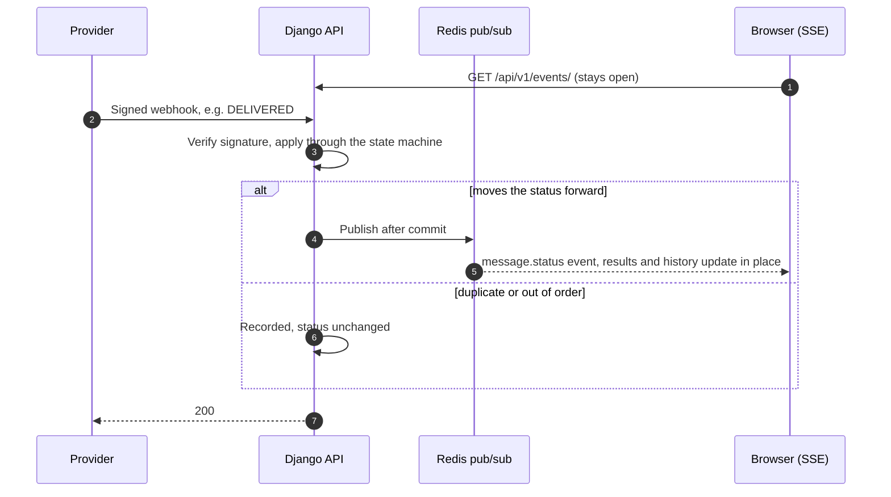

If the live connection drops, the UI polls instead (every 3 s for a send in progress, 15 s for the table) and refetches everything when the stream reconnects, since events sent meanwhile are lost.

### Failures and retries

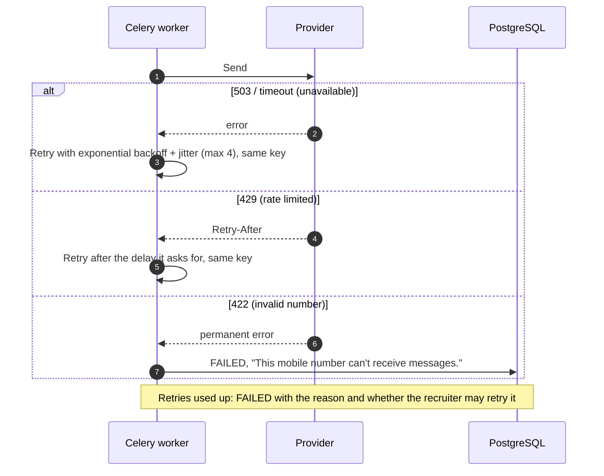

A failure reason is shown on the Failed chip (hover), in the send results and in the candidate's history.

### Missed webhooks

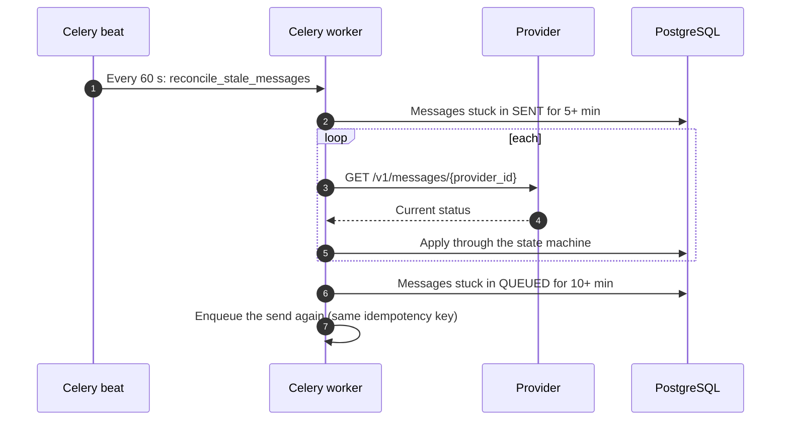

---

## Provider simulator

A real SMS provider cannot be made to fail on demand, costs money per message, and business SMS to Indian numbers needs TRAI DLT registration (sender ID and every template approved in advance). So the platform talks to its own stand-in vendor: a separate Django service reached only over HTTP, with the contract a real one has.

- `POST /v1/messages` with a Bearer API key; idempotent on `idempotency_key` (a replay returns the original response, a reused key with a different message is 409).
- A delivery lifecycle (accepted → sent → delivered → read, 1–4 s per step) reported by **HMAC-signed webhooks**, some deliberately duplicated or held back so they arrive out of order.
- `GET /v1/messages/{id}` for reconciliation, and `GET /health`.

Adding a real provider means one new adapter behind `MessagingGateway`; nothing else changes.

### Test numbers

The last four digits of the mobile number choose the outcome.

| Ends in | Outcome | What it shows |
| --- | --- | --- |
| `0000` | Rejected: the number can't receive SMS | Permanent failure, no retry, clear reason |
| `1111` | Sent, then delivery fails | Asynchronous failure via webhook |
| `2222` | Provider unavailable (503) twice, then accepted | Automatic retry with backoff, same idempotency key |
| `3333` | Rate limited (429) once, then accepted | Honouring `Retry-After` |
| `4444` | Delivered, never read | A message that stops at Delivered |
| anything else | Sent → Delivered → Read | The happy path |

`seed_demo_data` creates one candidate for each.

Numbers are checked for format when a candidate is added; whether a number can actually receive SMS (unallocated, landline, blocked) is only known when the provider rejects it at send time. `0000` stands in for that case.

### Fault injection

Simulate provider problems while the app is running; the platform keeps retrying and then fails messages with a recruiter-facing reason.

```bash
# Local: the key is SHARED_SIMULATOR_API_KEY in .env
curl -X POST http://127.0.0.1:8001/_demo/faults \
  -H "Authorization: Bearer <SIMULATOR_API_KEY>" -H "Content-Type: application/json" \
  -d '{"outage": true}'              # also: {"failure_rate": 0.5}, {"latency_ms": 3000}

curl http://127.0.0.1:8001/_demo/faults -H "Authorization: Bearer <SIMULATOR_API_KEY>"   # current values
```

## Bonus features

- **Retry failed messages.** Each failure is marked as retryable or not: a bad number or a bounced email isn't. Retry one message, or every failed one in a send. A retry is a new message linked to the failed one, so history keeps both. Each message can be retried once.
- **Provider health.** The header pill shows each provider's status and its counts for the last 24 hours. A banner appears when a provider is down.
- **Message templates.** Save and reuse messages. The box shows the template written for the first candidate, and every recipient gets it with their own name.
- **Scheduled messages.** Send from 1 minute to 30 days ahead; a beat job sends each one on time. If the candidate is deleted first, the message isn't sent.
- **Email through Resend.** **Send as** switches between SMS and email. Both providers sit behind the same gateway interface and report the same statuses.

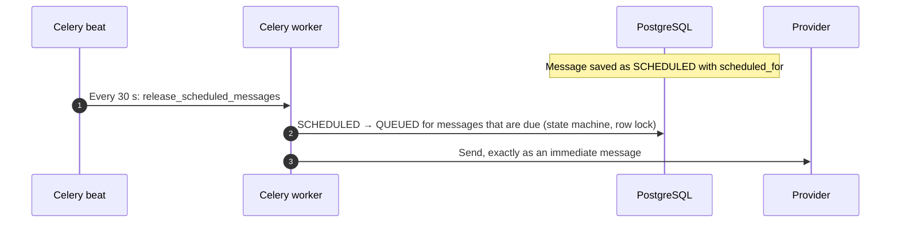

## Demo walkthrough

1. Open the app: the table shows each candidate's latest message and status. Search, sort (click a column name), filter by any column (the filter icons), and page through; the view lives in the URL.
2. **Add a candidate**: invalid input is explained next to the field, and a duplicate number or email is reported the same way.
3. **Send to one candidate**, then to several from different pages, starting from the "Interview invite" **template**: the box shows it written for the first candidate, and each recipient gets their own name. The drawer shows each recipient's status changing live: Sent → Delivered → Read.
4. **Send to the test-number candidates** together: two fail with different reasons, `2222`/`3333` recover after retries, `4444` stays Delivered.
5. **Turn on an outage**: the header turns to Down and a banner appears. Send to a couple of candidates and watch the automatic retries give up; turn the outage off and click **Retry failed**.
6. **Schedule** a message a couple of minutes ahead and watch it go out.
7. **Send as Email** to "Test Email Delivered" and "Test Email Bounced": one is delivered, the other bounces with a permanent reason.
8. Click a name to open the **communication history**, newest first, with channels, retries, scheduled times and failure reasons.
9. **Delete** one or several candidates.

---

## Key decisions

- **A simulated provider instead of Twilio.** Failures can be forced on demand, it costs nothing, and Indian SMS would need DLT registration. It still talks HTTP and signed webhooks like a real vendor.
- **One Celery task per message.** A bad number or a slow call holds up only that recipient.
- **Statuses only move forward.** Duplicate and late webhooks can't undo a status.
- **Idempotency keys on every send.** Retries, automatic or manual, never message anyone twice.
- **SSE for live updates**, with polling as a fallback. Updates only flow one way, so WebSockets would be overkill.
- **A reconciliation job.** A lost webhook can't leave a message stuck in Sent.
- **Frontend types generated from the API schema**, checked in CI, so the two can't drift apart.
- **Deleting a candidate hides them instead of erasing them.** Their message history stays on record, and messages already on their way still get their final status.

## Assumptions

- A single recruiter and **no login**: the brief does not ask for it. Permissions come from DRF's default settings, so authentication can be added without touching the views.
- Mobile numbers default to India (+91); any valid mobile number is accepted and stored in E.164. Validation covers the format only; reachability is reported by the provider at send time. Emails are stored lower-cased. Number and email are unique among active candidates.
- The table's **Status** and **Last message** are those of the candidate's latest message.
- Messages are 1–1000 characters; one send or bulk delete covers at most 500 candidates.
- The provider represents an SMS-style channel; "Read" stands for a read receipt such a channel can report.

### Beyond the design

Additions to the Figma screens:

- After sending, the drawer shows **live results** for each recipient.
- Extra statuses: **Queued**, **Delivered** and **Scheduled**.
- Working **column filters**, **sorting** (click a column name) and **search** by name, email, phone or the start of an ID.
- A character counter, Ctrl + Enter to send, and a prompt before an unsent message is discarded.
- Loading, empty and error states on every view.
- On phones the whole table scrolls; from tablet width up, the checkbox and name columns stay pinned.

## Deployment

Production is one GCP Compute Engine VM (e2-medium) running the same Compose stack with `docker-compose.prod.yml`:

- **nginx** is the only service with public ports. It serves `ccp.karthikdileep.in` (`/api/` to Django, unbuffered for SSE; everything else to Next.js) and `ccp-sim.karthikdileep.in` (the simulator), and redirects HTTP to HTTPS.
- **Let's Encrypt** certificates come from certbot on the host (`docker/nginx/issue-certs.sh`, once); Debian's certbot timer renews them.
- Both Django services run their production settings; secrets live only in the VM's `.env`.

```bash
GCP_PROJECT=... GCP_ZONE=... GCP_VM=... ./deploy.sh   # ships the committed HEAD and rebuilds on the VM
```

## What I would do next

- Cancel or reschedule a scheduled message.
- The table's "Last message" column dates a scheduled message by when it was created, so a message scheduled for next week shows today's date until it goes out. It should use the send time.
- Email open tracking needs a verified sending domain in Resend; with the shared test sender, emails stop at Delivered.
- For large tables, fetch each candidate's latest message with one lateral join instead of one subquery per column.
- Login (Django sessions), at which point the SSE view gets its own auth check.
